<div align="center">

# 📺 TV Dashboard

**Un tableau de bord plein écran pour TV Samsung (Tizen), composé de widgets que l'on dispose à la souris sur le PC.**

Horloge · Météo · Agenda · Anniversaires · Mot créole du jour · Bus · Sport · QR Wi-Fi · Musique YouTube · Photos


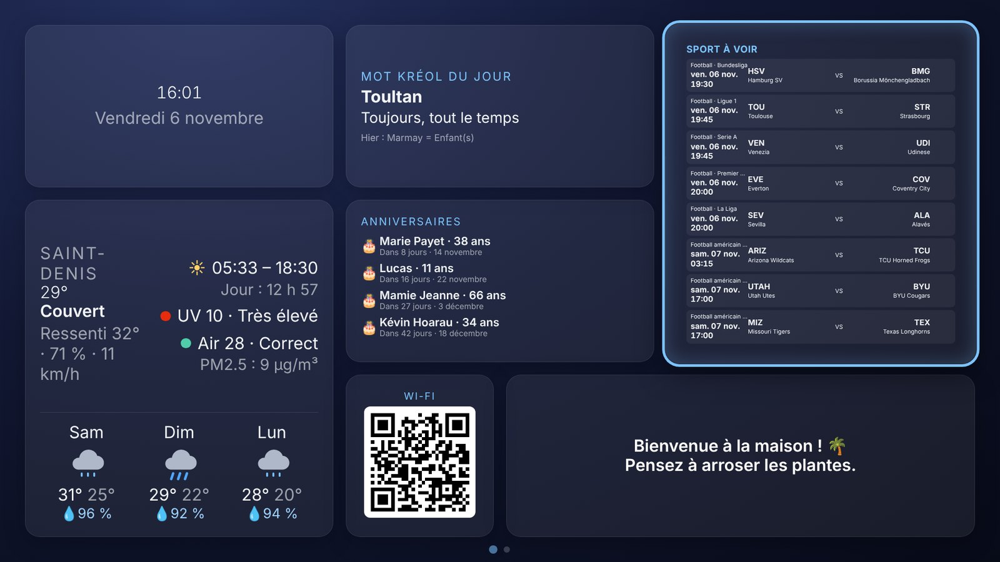

</div>

---

## Sommaire

1. [Présentation](#-présentation)
2. [Aperçu en images](#-aperçu-en-images)
3. [Comment ça marche](#-comment-ça-marche)
4. [Installation sur le PC](#-installation-sur-le-pc)
5. [Configurer le dashboard (page d'admin)](#-configurer-le-dashboard-page-dadmin)
6. [Installer sur la TV](#-installer-sur-la-tv)
7. [Utilisation sur la TV (télécommande)](#-utilisation-sur-la-tv-télécommande)
8. [Les widgets](#-les-widgets)
9. [Réglages généraux](#-réglages-généraux)
10. [Connecter YouTube (widget Musique)](#-connecter-youtube-widget-musique)
11. [Sauvegardes et historique](#-sauvegardes-et-historique)
12. [Créer son propre widget](#-créer-son-propre-widget)
13. [Commandes](#-commandes)
14. [Dépannage](#-dépannage)
15. [Vie privée](#-vie-privée)

---

## ✨ Présentation

TV Dashboard transforme une TV Samsung en écran d'information pour la maison : l'heure, la météo, les prochains
anniversaires, le QR code du Wi-Fi pour les invités, la musique… Le tout lisible à 3 mètres et piloté à 100 %
avec la télécommande.

- 🖱️ **Configuration visuelle** depuis le PC : on glisse les widgets sur une reproduction de l'écran de la TV,
  avec un aperçu en direct.
- 📄 **Plusieurs pages** (ex. « Maison » et « Invités »), qui se changent comme des chaînes avec **CH▲ / CH▼**.
- 🌙 **Veille automatique** : après un temps d'inactivité ou la nuit, l'écran s'assombrit et les widgets se
  mettent en pause.
- 🔒 **Tout reste chez vous** : aucun serveur, aucun compte à créer. La configuration est embarquée dans l'app
  installée sur la TV ; seules les API des widgets (météo, YouTube…) sont contactées.
- 🧩 **Extensible** : un widget = un dossier. Il est détecté automatiquement, sans registre à modifier.

---

## 🖼️ Aperçu en images

### Sur la TV

| Page « Maison » | Page « Invités » (CH▲ / CH▼) |
|---|---|
|  | 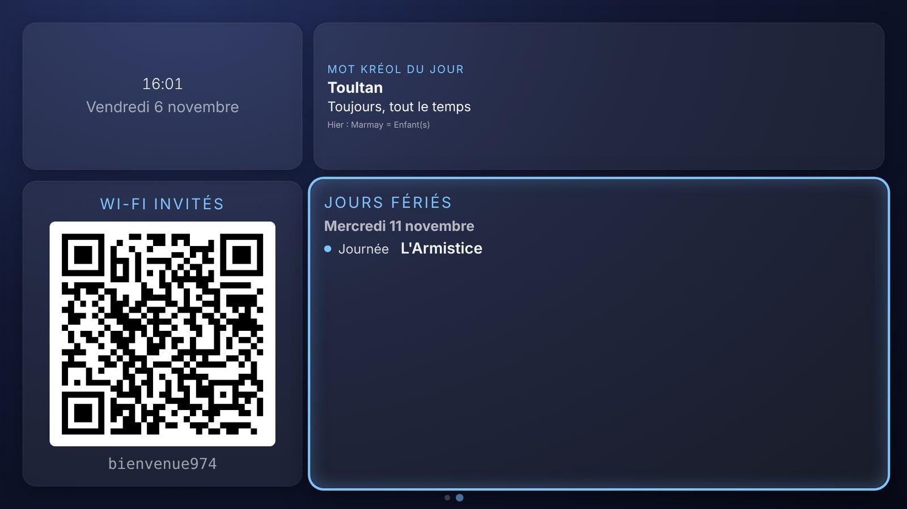 |

| OK sur la météo : prévisions plein écran | OK sur les anniversaires : liste et recherche |
|---|---|
| 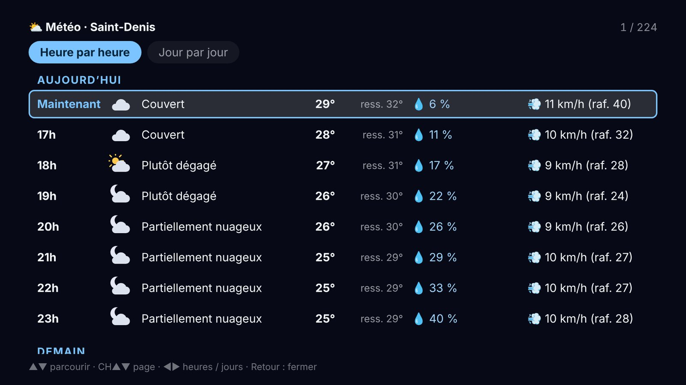 | 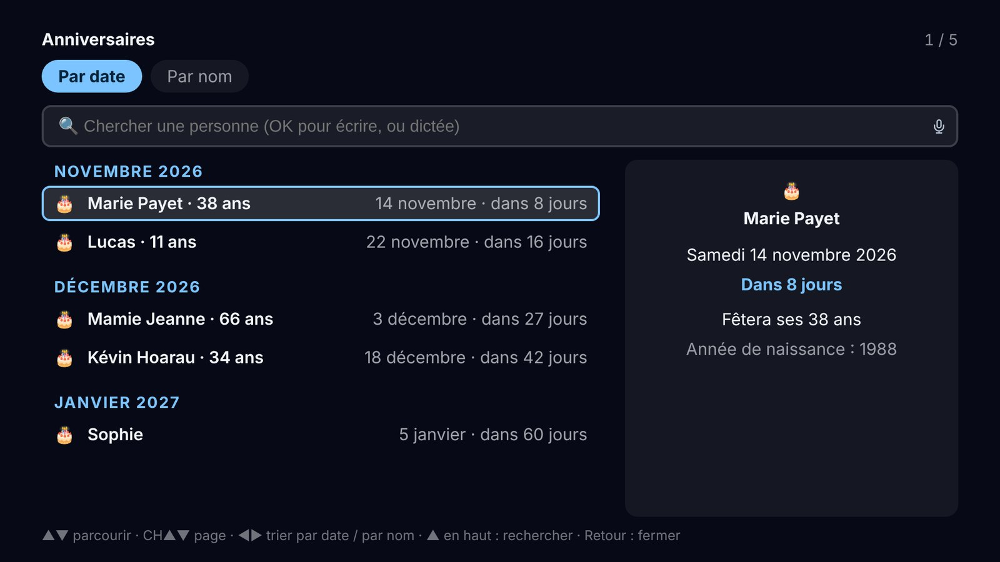 |

<p align="center">
  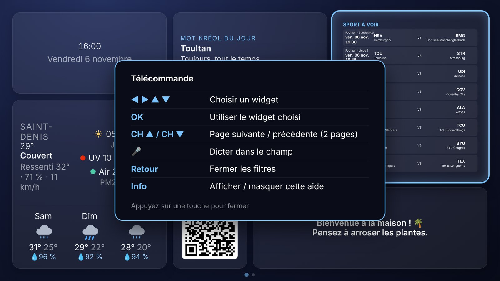<br>
  <em>Touche <b>Info</b> : aide de la télécommande, adaptée au widget sélectionné.</em>
</p>

### Sur le PC (page d'admin)

<p align="center">
  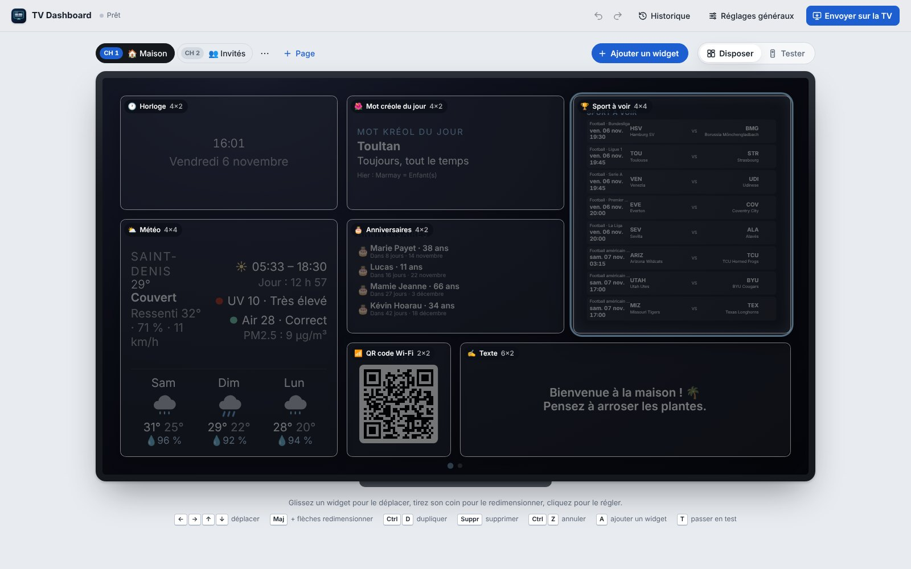<br>
  <em>L'écran de la TV reproduit à l'identique : glissez, redimensionnez, cliquez pour régler.</em>
</p>

| Réglages d'un widget | Réglages généraux |
|---|---|
| 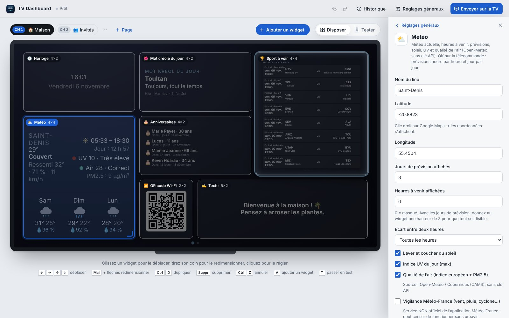 | 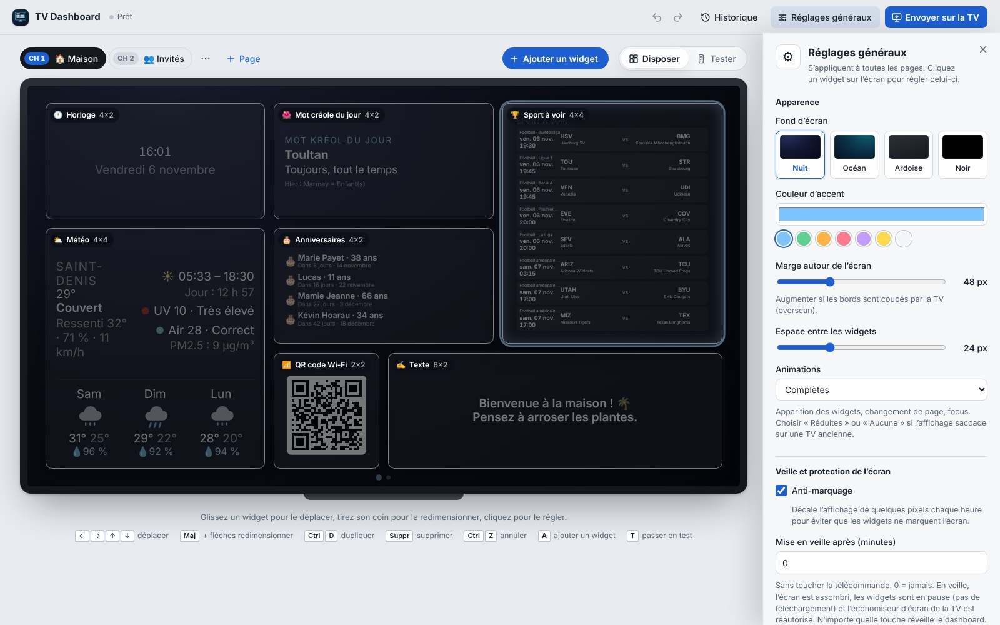 |

| « Ajouter un widget » | Mode Tester avec télécommande virtuelle |
|---|---|
| 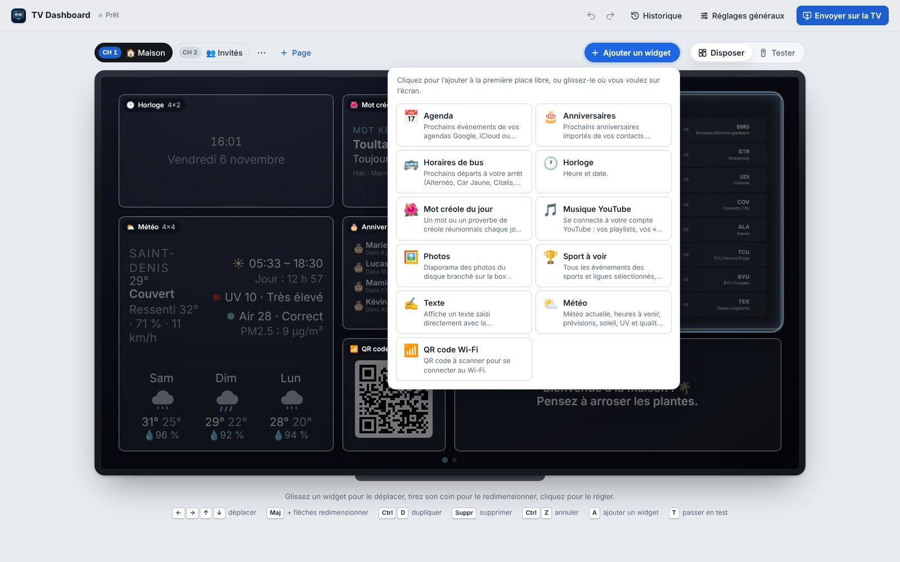 | 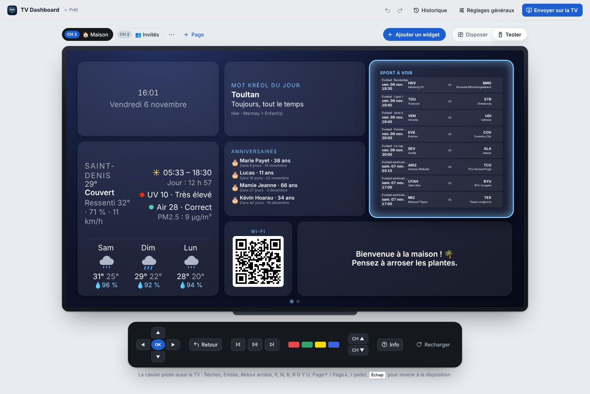 |

<p align="center">
  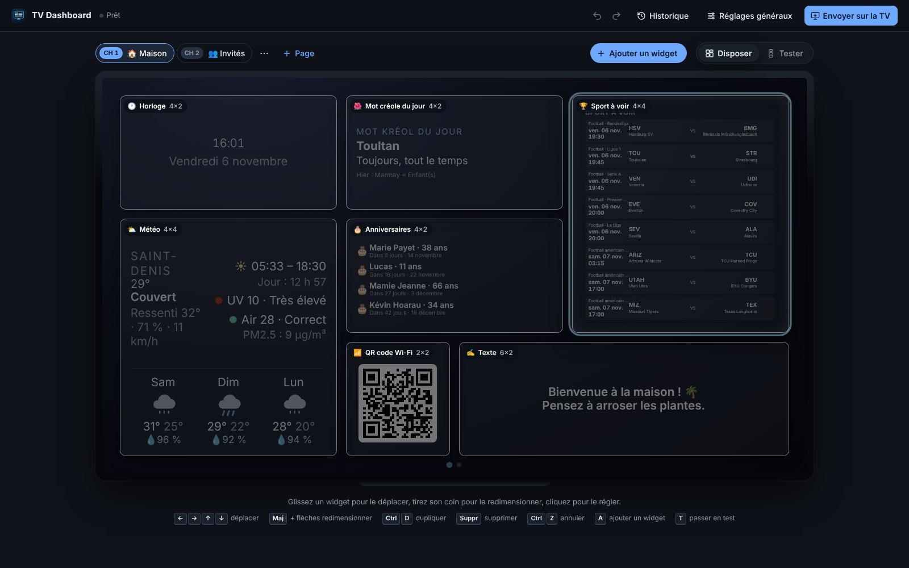<br>
  <em>L'admin suit le thème clair / sombre du système.</em>
</p>

---

## 🧭 Comment ça marche

```
        PC (pendant la configuration)                          TV Samsung (au quotidien)
 ┌──────────────────────────────────────┐              ┌──────────────────────────────────┐
 │  npm run dev → http://localhost:5173 │              │  App « TVDashboard » (Tizen)     │
 │  ├─ page d'admin + aperçu en direct  │   .wgt       │  ├─ config embarquée             │
 │  └─ config/dashboard.json            │ ───────────▶ │  ├─ widgets                      │
 │                                      │  « Envoyer   │  └─ démarre avec la TV           │
 │  npm run build / wgt / deploy        │  sur la TV » │                                  │
 └──────────────────────────────────────┘              └──────────────────────────────────┘
                                                                     │
                                                                     ▼  seulement les API des widgets
                                                         Open-Meteo, YouTube, iCal, bus…
```

1. Sur le PC, la page d'admin écrit vos choix dans `config/dashboard.json` (fichier personnel, ignoré par git).
2. Le build embarque cette config dans l'app TV (un seul fichier JavaScript, compatible avec les anciennes TV).
3. L'app est installée sur la TV. **La TV ne contacte jamais le PC** : celui-ci peut être éteint.
4. Après chaque modification, on renvoie l'app sur la TV (un clic).

---

## 💻 Installation sur le PC

### Prérequis

- [Node.js](https://nodejs.org) **20 ou plus** (Windows, macOS ou Linux) ;
- [Git](https://git-scm.com) (ou téléchargez le projet en ZIP depuis GitHub) ;
- une TV Samsung Tizen et le PC **sur le même réseau** (pour l'installation).

### Étapes

```bash
# 1. Récupérer le projet
git clone https://github.com/antoine-mady/tv-dashboard.git
cd tv-dashboard

# 2. Installer les dépendances (esbuild + générateur de QR code)
npm install

# 3. Lancer la page d'admin
npm run dev
```

Ouvrez ensuite **http://localhost:5173** dans votre navigateur.

Au premier lancement, `config/dashboard.json` est créé à partir de `config/dashboard.example.json` (deux pages
« Moi » et « Invités » d'exemple). Vous pouvez tout modifier depuis l'admin.

> 💡 Pour vérifier que tout fonctionne : `npm test` lance la suite de tests (`node --test`).

---

## 🛠️ Configurer le dashboard (page d'admin)

L'admin affiche **l'écran de la TV** (grille de 12 × 6 cases) avec l'aperçu en direct : ce que vous voyez est
exactement ce qui s'affichera sur la TV.

### Disposer les widgets

| Action | Souris | Clavier |
|---|---|---|
| Ajouter un widget | **+ Ajouter un widget**, puis clic (première place libre) ou glisser sur l'écran | `A` |
| Déplacer | glisser le cadre | flèches |
| Redimensionner | tirer le coin du cadre | `Maj` + flèches |
| Régler | cliquer sur le widget | `Tab` puis `Entrée` |
| Dupliquer | — | `Ctrl` + `D` |
| Supprimer | — | `Suppr` (annulable depuis la notification) |
| Annuler / Rétablir | ↶ ↷ en haut | `Ctrl` + `Z` / `Ctrl` + `Y` |
| Fermer le panneau de réglages | ✕ ou clic dans le vide | `Échap` |

Le panneau de réglages glisse depuis la droite : le formulaire est généré automatiquement pour chaque widget
(champs, curseurs, couleurs, aide…). Les changements sont appliqués **immédiatement** dans l'aperçu, sans
rechargement.

### Les pages (chaînes)

Les pages apparaissent comme des chaînes : **CH 1**, **CH 2**… au-dessus de l'écran.

- **+ Page** pour en créer une ; le menu **⋯** permet de la renommer, la dupliquer, la déplacer ou la supprimer.
- Chaque page a ses propres widgets ; les **réglages généraux** (fond, couleur, veille…) sont communs.
- Astuce : un widget **identique** (même place, mêmes réglages) sur deux pages n'est pas recréé au changement de
  page — la musique continue de jouer, par exemple.

### Tester comme sur la TV

Le bouton **Tester** transforme l'aperçu en TV : une **télécommande cliquable** apparaît sous l'écran, et le
clavier pilote le dashboard :

| Touche du clavier | Touche de la télécommande |
|---|---|
| Flèches, `Entrée`, `Retour arrière` | ◀ ▶ ▲ ▼, OK, Retour |
| `P` / `N` / `B` | ⏯ Lecture-pause / ⏭ Suivant / ⏮ Précédent |
| `R` / `G` / `Y` / `U` | Touches rouge / verte / jaune / bleue |
| `Page↑` / `Page↓` | CH▲ / CH▼ |
| `I` | Info (aide) |
| `F2` | Micro (dictée vocale) |

`Échap` ou **Disposer** pour revenir à l'édition.

---

## 📲 Installer sur la TV

Deux méthodes au choix. **Apps2Samsung** est la plus simple ; **Tizen Studio** permet ensuite d'envoyer chaque
mise à jour en un clic depuis l'admin.

### Étape commune : activer le mode développeur de la TV

1. Sur la TV, ouvrez **Apps**.
2. Tapez **`1` `2` `3` `4` `5`** avec la télécommande (pavé numérique ou télécommande virtuelle).
3. Activez **Developer mode** et saisissez l'**adresse IP du PC** qui fera l'installation.
4. Redémarrez **complètement** la TV : débranchez-la 30 secondes.

> ⚠️ Laissez le mode développeur **activé** : les apps installées ainsi peuvent disparaître s'il est désactivé.

L'IP de la TV se trouve dans *Paramètres → Général → Réseau → État du réseau*.

### Méthode A — Apps2Samsung (sans Tizen Studio)

[Apps2Samsung](https://github.com/Apps2Samsung/Apps2Samsung) gère lui-même le certificat Samsung et
l'installation.

1. **Créer le paquet** : dans l'admin, cliquez sur **📺 Envoyer sur la TV** → **Télécharger le .wgt** (proposé
   quand Tizen Studio n'est pas installé), ou en ligne de commande :
   ```bash
   npm run wgt
   ```
   Cela produit `TVDashboard.wgt` (non signé : Apps2Samsung le signe lui-même).
2. **Installer** : dans Apps2Samsung, choisissez l'installation d'un **WGT personnalisé**, sélectionnez
   `TVDashboard.wgt`, la TV détectée, puis lancez l'installation. La première fois, la connexion au compte
   Samsung est demandée pour le certificat.
3. Après chaque changement de config : nouveau `.wgt`, puis réinstallation avec Apps2Samsung.

### Méthode B — Tizen Studio (bouton « Envoyer sur la TV »)

1. **Installer [Tizen Studio](https://developer.tizen.org/development/tizen-studio/download)** (la version
   « CLI » suffit), puis, dans le *Package Manager*, les extensions **Samsung TV** : « TV Extensions » et
   « Samsung Certificate Extension ».
2. **Créer un certificat Samsung** : *Tools → Certificate Manager* → **+** → *Samsung* → *TV*. Créez le
   certificat auteur et le certificat distributeur (compte Samsung requis) en ajoutant le **DUID** de la TV
   (détecté automatiquement si la TV est connectée dans le *Device Manager*). Notez le **nom du profil**.
3. **Configuration locale** : copiez `.env.example` en `.env.local` et complétez :
   ```ini
   # IP de la TV (Paramètres > Général > Réseau > État du réseau)
   TV_IP=192.168.1.50
   # Nom du profil de certificat créé dans Tizen Studio
   TIZEN_PROFILE=tv-dashboard
   # Dossier de Tizen Studio (optionnel si `tizen` et `sdb` sont dans le PATH)
   TIZEN_HOME=~/tizen-studio
   ```
4. **Envoyer** : cliquez sur **📺 Envoyer sur la TV** dans l'admin, ou :
   ```bash
   npm run deploy
   ```
   L'app est buildée, signée, installée puis lancée sur la TV (environ 10 secondes). À refaire après chaque
   modification.

### Démarrage automatique avec la TV

*Paramètres → Général → Fonctions Smart → **Exécution auto. dernière app*** (*Autorun Last App*) = **ON**, puis
lancez une fois « TVDashboard » depuis la liste des apps. Le dashboard se relancera à chaque allumage.

---

## 🎮 Utilisation sur la TV (télécommande)

| Touche | Action |
|---|---|
| ◀ ▶ ▲ ▼ | Choisir un widget (le widget sélectionné est entouré d'une lueur) |
| **OK** | Utiliser le widget : ouvrir son panneau plein écran, photo suivante, modifier le texte… |
| **Retour** | Fermer le panneau ouvert |
| **CH▲ / CH▼** | Page suivante / précédente (le nom de la page s'affiche, les points en bas indiquent la page) |
| ⏮ ⏯ ⏭ | Musique : précédent, lecture / pause, suivant — même si le widget n'est pas sélectionné |
| 🔴 Rouge | Ouvrir l'app YouTube officielle (widget Musique) |
| 🎤 Micro | Dictée vocale dans un champ texte (TV récentes) |
| **Info** | Afficher l'aide de la télécommande |

Dans les panneaux plein écran (agenda, anniversaires, bus, météo…) : **▲▼** pour parcourir, **CH▲ / CH▼** pour
aller plus vite, **◀ ▶** pour changer d'onglet, **Retour** pour fermer.

**Veille** : si elle est activée dans les réglages généraux, l'écran s'assombrit après N minutes sans toucher la
télécommande (ou la nuit) et les widgets cessent de se mettre à jour. **N'importe quelle touche réveille** le
dashboard, qui rattrape aussitôt les données.

---

## 🧩 Les widgets

| Widget | Ce qu'il affiche | Configuration |
|---|---|---|
| 🕐 **Horloge** | Heure et date | Fuseau horaire, secondes, date |
| ⛅ **Météo** | Météo actuelle, heures à venir, prévisions, soleil, UV, qualité de l'air. **OK** : prévisions plein écran heure par heure (10 jours) et jour par jour | Lieu + coordonnées (clic droit dans Google Maps). [Open-Meteo](https://open-meteo.com), **sans clé API** |
| 📅 **Agenda** | Prochains événements. **OK** : 90 jours avec le détail (horaire, lieu, description), un onglet par agenda | Adresses iCal (Google, iCloud, Outlook) — sans compte ni clé |
| 🎂 **Anniversaires** | Prochains anniversaires avec l'âge. **OK** : toute l'année, triée par date ou par nom, avec recherche | Import de contacts Google (vCard) ou agendas iCal |
| 🌺 **Mot créole du jour** | Un mot ou proverbe de créole réunionnais par jour, avec sa traduction et le rappel de la veille | Possibilité d'ajouter ses propres mots |
| 🚌 **Horaires de bus** | Prochains départs à votre arrêt, retards en temps réel (Alternéo, Car Jaune). **OK** : tous les horaires jusqu'à demain soir, un onglet par ligne | « Chercher l'arrêt » puis « Choisir » dans l'admin. Réseaux de La Réunion, données de [transport.data.gouv.fr](https://transport.data.gouv.fr). Le widget prévient 7 jours avant la nouvelle saison d'horaires : « Mettre à jour les horaires » puis renvoyer sur la TV |
| 🏆 **Sport à voir** | Calendrier unifié : football (Ligue 1, Premier League, Liga, Bundesliga, Serie A, Ligue des champions), rugby, League of Legends. **OK** : choix des ligues | Clé [CitoAPI](https://citoapi.com) facultative (LoL uniquement). Détails dans [INTEGRATION.md](INTEGRATION.md) |
| 📶 **QR code Wi-Fi** | QR code à scanner pour se connecter au Wi-Fi, mot de passe affiché en option | Nom du réseau, sécurité, mot de passe |
| ✍️ **Texte** | Un message libre (« Bienvenue ! », une liste de courses…) | **OK** sur la TV pour l'écrire avec le clavier ou à la voix ; alignement, taille, couleur dans l'admin |
| 🎵 **Musique YouTube** | Vos playlists, vos « J'aime », la recherche, avec boutons ⏮ ⏯ ⏭ ☰ à l'écran. ☰ = bibliothèque plein écran | Identifiants Google — voir [Connecter YouTube](#-connecter-youtube-widget-musique) |
| 🖼️ **Photos** | Diaporama des photos du disque branché sur la box (DLNA/UPnP) ou d'une clé USB sur la TV. **OK** = photo suivante | « Rechercher la box » trouve l'adresse automatiquement (partage multimédia à activer sur la box) |

En cas de problème, chaque widget affiche un message clair avec un conseil (« Renseignez la ville dans l'admin »,
« Nouvel essai automatique… ») au lieu d'un écran vide.

---

## ⚙️ Réglages généraux

Bouton **Réglages généraux** en haut de l'admin. Ils s'appliquent à toutes les pages.

| Réglage | Rôle |
|---|---|
| **Fond d'écran** | Nuit, Océan, Ardoise ou Noir |
| **Couleur d'accent** | Couleur des titres et de la sélection |
| **Marge autour de l'écran** | À augmenter si les bords sont coupés par la TV (overscan) |
| **Espace entre les widgets** | Écart entre les cadres |
| **Animations** | Complètes, réduites ou aucune (pour une TV ancienne qui saccade) |
| **Anti-marquage** | Décale l'affichage de quelques pixels chaque heure pour protéger l'écran |
| **Mise en veille après (minutes)** | 0 = jamais. En veille, écran assombri et widgets en pause |
| **Veille la nuit** + début / fin | Veille automatique la nuit (ex. 23:00 → 07:00) |
| **Assombrissement en veille** | Intensité de l'assombrissement |
| **Touche couleur pour changer de page** | Pour les télécommandes sans touches CH |
| **Rouvrir la dernière page au démarrage** | Sinon, la TV démarre sur la première page |

---

## 🎵 Connecter YouTube (widget Musique)

YouTube Music n'a pas d'API publique : le widget utilise l'**API officielle YouTube Data v3** avec votre compte
Google, et le lecteur YouTube intégré pour la lecture.

1. **Identifiants Google** (une seule fois, ~15 min, gratuit). Le guide détaillé avec les liens s'affiche dans
   l'admin quand on sélectionne le widget :
   - créer un projet sur la [Google Cloud Console](https://console.cloud.google.com/projectcreate) ;
   - activer l'**API YouTube Data v3** ;
   - configurer l'écran de consentement OAuth (« Externe ») puis le **publier en production** — sinon la
     connexion expire au bout de 7 jours (l'avertissement « application non validée » est normal pour un usage
     personnel) ;
   - créer un **ID client OAuth** de type **« TV et appareils à saisie limitée »** ;
   - coller l'ID et le secret dans l'admin, puis **Tester les identifiants**.
2. **Sur la TV** : sélectionnez le widget, **OK**, puis scannez le QR code avec votre téléphone (ou ouvrez
   `google.com/device`) et saisissez le code affiché. La connexion est mémorisée **sur la TV** uniquement (ni dans
   la config, ni dans git). « Se déconnecter » se trouve dans la bibliothèque.

<details>
<summary><b>Pourquoi une « page lecteur » sur GitHub Pages ?</b></summary>

YouTube refuse de lire une vidéo dans une app installée localement sur la TV (erreur 153 : une app locale n'a
pas d'adresse web). Le lecteur tourne donc dans la petite page [`player/`](player/), publiée sur GitHub Pages
(`https://antoine-mady.github.io/tv-dashboard/player/`), que le widget ouvre en arrière-plan et pilote par
messages. Elle ne contient et ne reçoit **aucune donnée personnelle** (seulement les identifiants des morceaux).

Pour l'héberger ailleurs : changez « Adresse de la page lecteur » dans l'admin et ajoutez son origine à
`frame-src` dans `tizen/config.xml`.
</details>

**Limites imposées par YouTube :**
- pas de mixes ni de recommandations personnalisées YouTube Music ; les « J'aime » sont ceux du compte YouTube ;
- le lecteur intégré n'est pas connecté au compte : **les pubs ne sont pas garanties absentes** malgré Premium
  (la touche rouge ouvre l'app YouTube officielle, connectée à Premium) ;
- quota gratuit : ~100 recherches par jour (les listes sont mises en cache 30 min et ne coûtent presque rien).

---

## 💾 Sauvegardes et historique

- À chaque **envoi sur la TV** ou création de `.wgt`, une copie de la config est enregistrée dans
  `config/history/` (ignoré par git).
- Le bouton **Historique** de l'admin permet de **restaurer** une ancienne version, et d'**exporter / importer**
  la config en JSON (pratique pour changer de PC).
- Pendant l'édition, **Annuler / Rétablir** (`Ctrl+Z` / `Ctrl+Y`) couvre toutes les modifications.

---

## 🧑‍💻 Créer son propre widget

```bash
npm run new-widget mon-widget "Mon widget"
```

Cela crée `widgets/mon-widget/` à partir du modèle. Tout le widget tient dans ce dossier :

```
widgets/mon-widget/
├── manifest.js     # nom, icône, taille, champs de réglage (formulaire généré automatiquement)
├── tv.js           # rendu sur la TV : class extends Widget { mount(el, settings) { … } }
├── tv.css          # styles (chaque sélecteur commence par .w-mon-widget)
├── admin.js        # (optionnel) boutons / assistants supplémentaires dans l'admin
├── server.js       # (optionnel) routes exécutées sur le PC, dans l'admin uniquement
└── *.test.js       # tests de la logique pure
```

Exemple minimal de `manifest.js` :

```js
export default {
  type: 'mon-widget',
  name: 'Mon widget', icon: '🧩', description: 'Ce que fait le widget.',
  size: { default: { w: 3, h: 2 }, min: { w: 2, h: 1 } },
  schema: [
    { key: 'city', label: 'Ville', type: 'text', default: 'Saint-Denis', required: true },
  ],
};
```

Le widget est **découvert automatiquement** : relancez `npm run dev` et il apparaît dans « Ajouter un widget ».
Le guide complet (contrats, utilitaires `this.every`, `this.fetchJson`, panneaux plein écran, stockage sur la
TV, règles de compatibilité Chrome 56…) est dans **[CLAUDE.md](CLAUDE.md)**.
Références : [`widgets/clock/`](widgets/clock/) (le plus simple) et [`widgets/photos/`](widgets/photos/) (complet).

---

## 📋 Commandes

| Commande | Rôle |
|---|---|
| `npm run dev` | Page d'admin + aperçu en direct sur http://localhost:5173 |
| `npm test` | Lance tous les tests (`node --test`) |
| `npm run build` | Build de production dans `dist/` (échoue si la config est invalide) |
| `npm run wgt` | Build + `TVDashboard.wgt` non signé (pour Apps2Samsung) |
| `npm run deploy` | Build + paquet signé + installation + lancement sur la TV (`.env.local` requis) |
| `npm run new-widget <type> "Nom"` | Crée un nouveau widget depuis le modèle |

Variables facultatives pour `npm run dev` : `PORT` (défaut `5173`) et `HOST` (défaut `127.0.0.1`).

### Arborescence

```
widgets/<type>/   un dossier = un widget (TV + admin + serveur + tests + assets)
app/              cœur de l'app TV (grille, télécommande, pages, veille, animations…)
admin/            page d'admin (serveur, éditeur de grille, formulaires, historique)
tools/            build, deploy, .wgt, découverte des widgets, générateur
tizen/            config.xml (manifeste Tizen, privilèges, CSP) + icônes
player/           page lecteur YouTube publiée sur GitHub Pages
config/           dashboard.example.json (versionné) ; dashboard.json (perso, ignoré par git)
docs/screenshots/ captures d'écran de ce README
```

---

## 🩺 Dépannage

| Problème | Solution |
|---|---|
| **« Connexion impossible » à l'envoi** | Vérifiez que la TV est allumée, en *Developer mode* avec l'IP **du PC**, et sur le même réseau. Après avoir changé l'IP, redémarrez la TV (débranchée 30 s). |
| **Le bouton « Envoyer » ne propose qu'un .wgt** | Tizen Studio n'est pas détecté : installez-le (méthode B) ou utilisez Apps2Samsung (méthode A). Vérifiez `TIZEN_HOME` dans `.env.local`. |
| **Bords de l'écran coupés** | Augmentez *Marge autour de l'écran* dans les réglages généraux. |
| **L'app a disparu de la TV** | Le mode développeur a probablement été désactivé : réactivez-le et réinstallez. |
| **Le dashboard ne démarre pas avec la TV** | Activez *Exécution auto. dernière app* et lancez l'app une fois à la main. |
| **Un widget affiche une erreur** | Lisez le conseil affiché : réglage manquant dans l'admin, ou nouvel essai automatique si le service est injoignable. |
| **L'affichage saccade** | Réglez *Animations* sur « Réduites » ou « Aucune ». |
| **Photos : aucune image** | Activez le partage multimédia DLNA/UPnP sur la box, puis « Rechercher la box » dans l'admin. Sinon, utilisez une clé USB branchée sur la TV. |
| **Musique : connexion perdue après 7 jours** | Publiez l'écran de consentement OAuth « en production » dans la Google Cloud Console. |
| **Voir la console de la TV** | Développez dans l'aperçu (`npm run dev`), qui exécute le même code. Sur la TV : ouvrez `dist/` comme projet dans Tizen Studio → *Debug As → Tizen Web Application*. |

---

## 🔐 Vie privée

- **Aucun service en ligne** propre au projet : pas de serveur, pas de compte, pas de statistiques.
- La configuration (mot de passe Wi-Fi, identifiants…) reste dans `config/dashboard.json` sur le PC (ignoré par
  git) et dans l'app installée sur la TV.
- Les connexions apprises sur la TV (ex. YouTube) restent dans le stockage local de la TV.
- Seules sortent les requêtes vers les services des widgets eux-mêmes (Open-Meteo, YouTube, vos agendas iCal,
  transport.data.gouv.fr…).
